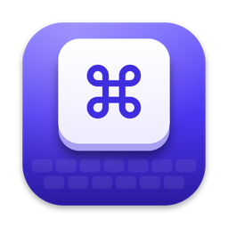
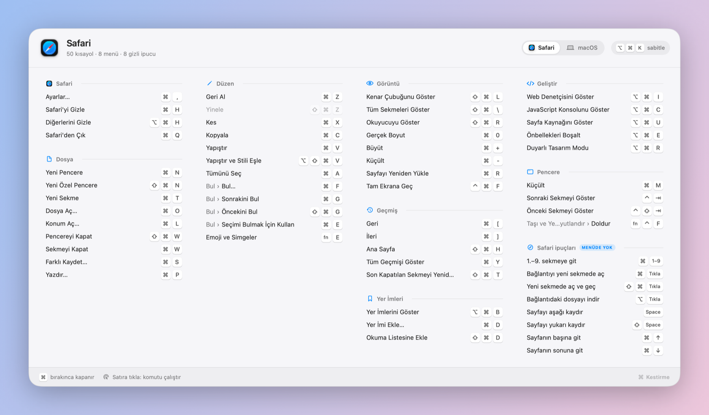
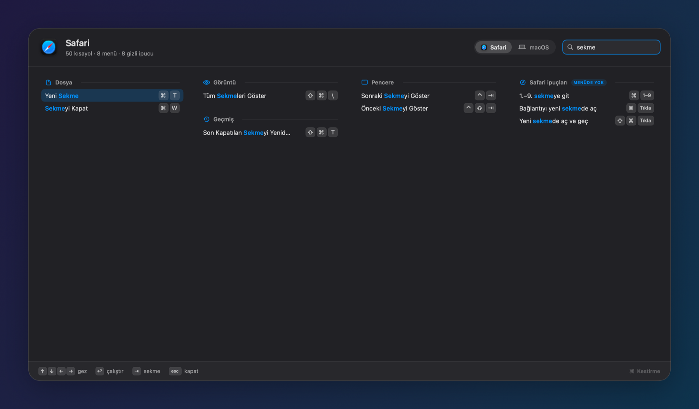
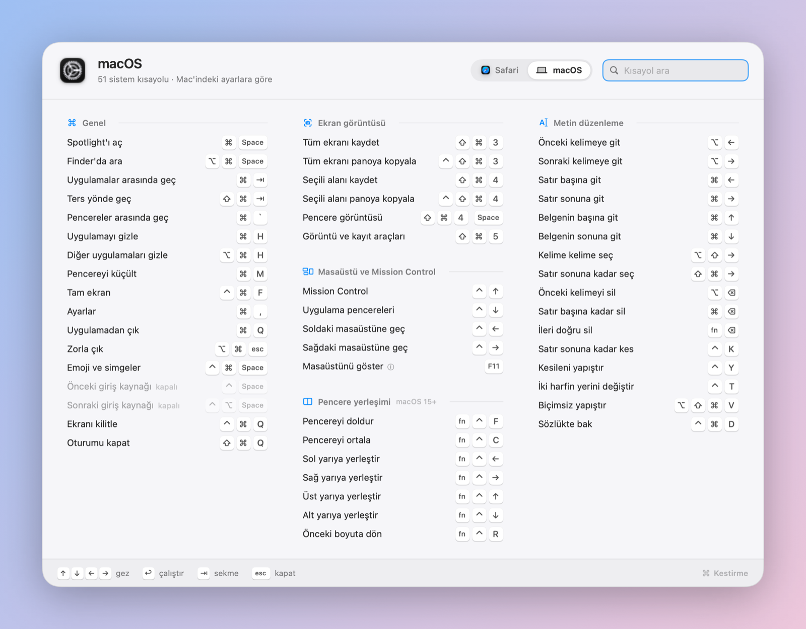

<p align="center">
  
</p>

<h1 align="center">Kestirme</h1>

<p align="center">
  <strong>Her Mac uygulamasının klavye kısayolları, bir tuş uzağında.</strong><br>
  ⌘ tuşunu basılı tut, öndeki uygulamanın tüm kısayolları ekrana gelsin; bırakınca kaybolsun.
</p>

<p align="center">
  
</p>

---

## Kurulum

```sh
brew install --cask falconsw/tap/kestirme
```

Güncelleme: `brew upgrade --cask kestirme` · Kaldırma: `brew uninstall --cask kestirme` (`--zap` ayarları da siler).
DMG: [Releases](https://github.com/falconsw/kestirme/releases). macOS 14 ve sonrası; Apple Silicon ve Intel.

İlk açılışta **Erişilebilirlik** izni ister (Sistem Ayarları › Gizlilik ve Güvenlik › Erişilebilirlik). Bu izin menüleri okumak ve ⌘ tuşunu algılamak için gerekli. Kestirme ağa hiç bağlanmaz.

## Neden

Statik cheatsheet'ler ([örnek](https://github.com/ruzickap/cheatsheet-macos)) elle yazılır, birkaç uygulamayla sınırlı kalır ve eskir. Kestirme kısayolları o an kullandığın uygulamadan okur:

| | Statik PDF cheatsheet | Kestirme |
| --- | --- | --- |
| Kapsam | Elle seçilmiş birkaç uygulama | **Her uygulama**: menüler canlı okunur |
| Güncellik | Elle güncellenir | Uygulama ne gösteriyorsa o, kendi dilinde |
| Sistem kısayolları | Varsayılanlar | **Senin ayarların**: kapattığın ya da değiştirdiğin kısayollar, Rectangle tercihleri |
| Gizli kısayollar | Bir kısmı | Menüde görünmeyenler (⌘-tıkla, Hızlı Bakış, kabuk tuşları, VS Code akorları…) |
| Arama | Yok | Komut adıyla ya da `cmd shift k` gibi tuşlarla |
| Çalıştırma | Yok | Satıra tıkla veya ↩: komut uygulamada çalışır |
| Dışa aktarma | PDF | Her uygulama için tek tıkla **PDF** veya **Markdown** |

<p align="center">
  
</p>

## Kullanım

| Tuş | İş |
| --- | --- |
| ⌘ basılı tut | Paneli göster (bırakınca kapanır, başka tuşa basınca açılmaz) |
| ⌥⌘K | Aç / kapat; ⌘ basılıyken basarsan paneli sabitler |
| yaz | Ara |
| ↑ ↓ ← → | Kısayollar arasında gez |
| ↩ | Seçili komutu çalıştır |
| ⇥ · ⌘1 · ⌘2 | Uygulama ↔ macOS sekmesi |
| ⌘S | PDF olarak kaydet |
| esc | Aramayı temizle / kapat |

**macOS** sekmesi sistem genelindeki kısayolları gösterir: Spotlight, ekran görüntüsü, Mission Control, pencere yerleşimi ve metin düzenleme. Değerler Mac'indeki ayarlardan okunur.

<p align="center">
  
</p>

Kestirme arka planda çalışır. Dock'ta görünmez ve kendini giriş öğelerine ekler (Ayarlar'dan kapatılabilir). Bekleme süresini ve kısayol tuşunu menü çubuğundaki ⌘ simgesinden açılan **Ayarlar…** bölümünde değiştirebilirsin. Simge oradan ya da ⌘ ile menü çubuğundan dışarı sürüklenerek gizlenebilir. Gizliyken Kestirme'yi Spotlight'tan yeniden açarsan Ayarlar açılır.

## Kendi kısayolların

Menü çubuğu › **Kendi Kısayollarını Düzenle…** şu dosyayı açar: `~/Library/Application Support/Kestirme/kisayollar.json`. Dosyanın biçimi gömülü [`Resources/Library.json`](Resources/Library.json) ile aynı:

```json
{
  "apps": [
    { "bundleIDs": ["com.googlecode.iterm2"],
      "groups": [{ "group": "Midnight Commander", "symbol": "folder",
                   "items": [{ "title": "Dosyayı kopyala", "keys": "f5" }] }] }
  ],
  "system": [
    { "group": "Benim kısayollarım", "items": [{ "title": "Raycast", "keys": "opt+space" }] }
  ]
}
```

`keys` alanında `cmd`, `shift`, `opt`, `ctrl` ve `fn` bir tuşla birleştirilir: `k`, `f5`, `return`, `tab`, `space`, `esc`, `delete`, `up/down/left/right`, `click`, `drag`. Ardışık basışlar boşlukla ayrılır: `cmd+k cmd+s`.

## Derleme

```sh
./scripts/build.sh --run          # build/Kestirme.app derle ve çalıştır
./scripts/dev-render.sh <klasör>  # paneli örnek veriyle PNG olarak çiz
./scripts/release.sh              # evrensel, noter onaylı DMG (dist/)
```

Gereksinim: Xcode 16+ (Swift 6). Uygulama SwiftUI + AppKit ile yazıldı. Menüler Accessibility API ile okunuyor, ⌘ basılı tutma bir event tap ile algılanıyor.

## Lisans

[MIT](LICENSE)
